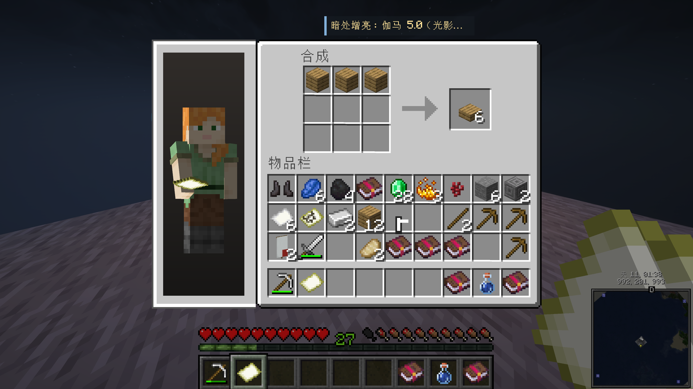

# Curio Observer

<p>
  <a href="LICENSE"></a>
  <a href="https://github.com/LudensAgent/Curio-Observer/releases"></a>
  
  
  
  <a href="https://github.com/LudensAgent/Curio-Observer/actions/workflows/build.yml"></a>
  <a href="https://github.com/LudensAgent/Curio-Observer/releases"></a>
</p>

[English](README.md) | 简体中文

用于附身观察 Mineflayer bot 的客户端 HUD 模组，适用于 Minecraft 1.20.1（Fabric）。
显示 bot 的背包、合成、容器和村民交易，并提供第一人称手持、暗处增亮和自适应相机。



*游戏内工作台效果：被观察 bot 的角色与 3×3 合成网格、产物槽、背包和快捷栏同时显示。*

模组安装在观察者客户端，桥接运行在**实际被观察 bot 所在的进程**，通过 HTTP SSE 输出窗口事件。
无需 Minecraft 服务端插件或模组。容器 HUD 只读，不发送物品操作包。可选的自动观察会发送
`/spectate <bot>`，必要时先发送 `/gamemode spectator`；观察者需要这些命令的服务端权限。

## 功能

- **旁观 HUD**：`vitals`（生命/护甲/饥饿/氧气/经验）、`inventory`（装备/背包/副手/主手）、`view`（画面辅助状态）、`hands`（第一人称手持及挥手、进食、使用动画）。生命条按目标的实际最大生命值显示。
- **暗处增亮**：替换光图 gamma，在黑暗/洞穴中看得更清楚。
- **自动视角**：旁观时自适应第三人称/第一人称的广播相机。
- **可选 RCON 通道**：没有匹配的 bot 数据流时，可从开启 `enable-rcon=true` 的服务端拉取被观察玩家的完整背包与饥饿／经验数据。
- **实时容器 HUD**：背包／工作台合成、箱子／木桶／末影箱／潜影盒、漏斗／发射器、砂轮／锻造结果、铁砧重命名与费用、附魔选项、熔炉／酿造进度及村民报价。
- **角色与物品动画**：背包和工作台布局显示被观察玩家的皮肤、装备与手持物品；变化槽位高亮，携带物品移动、转移与丢弃动画保留真实堆叠数量。
- **自动观察与双语设置**：在 **K** 设置中指定目标与重新附身间隔，切换中文／英文，调整 HUD 缩放、面板显隐和亮度。
- **公开接入协议**：独立 Mineflayer 桥接、数据示例、重连快照与真实物品 NBT。数据仅应用于同名被观察玩家。
- **可交互验收 bot**：22 个真实 Minecraft 场景覆盖背包、合成、存储、工作站、交易和批量丢弃，支持终端控制与可选操作节奏。

## 接入 Mineflayer bot

将 [`integrations/mineflayer`](integrations/mineflayer) 复制到 bot 项目，或作为本地包安装。
它没有运行时依赖，不需要另一个 Curio 仓库。使用 Node.js 22+。

在实际 bot 首次 spawn、背包插件已就绪后安装一次：

```js
import { installMineflayerObserver } from './integrations/mineflayer/index.js';

let observer;
bot.once('spawn', async () => {
  observer = installMineflayerObserver(bot);
  await observer.listen({ port: 3000 });
});

// 重建 bot 或退出时，先清理旧接入：
// await observer?.dispose();
```

需要接近玩家的操作节奏时，安装桥接时传入 `{ actionPacing: { intervalMs: 220 } }`。
它会在 bot 的真实点击之间停留，让合成、单件放置和整组搬运能被观察；应按顺序 `await` bot 操作。
定量丢弃会先整理出实际数量，再按批次丢出，HUD 保留每次操作的数量。普通桥接默认不改变 bot 速度，
本仓库的测试端默认启用此节奏；HUD 不积压或慢放旧背包快照。

### 开始观察

观察者加入同一 Minecraft 服务器，进入旁观模式并附身该 bot。按 **K** 填写上述接入方式对应的数据 URL，
模组默认值为 `http://127.0.0.1:3000/api/observer/stream`。桥接默认监听本机；bot 在另一台机器时，
按接入指南配置监听地址和模组 URL。模组支持 HTTP/HTTPS，断线自动重连。
另开一个旁观 bot 无法提供其他 bot 的私有窗口数据。

在 **K** 设置中填写**默认观察玩家**（例如 `Alex`），打开**自动附身观察**并指定间隔。
目标出现在服务器玩家列表后，模组会定时尝试附身；必要时先请求进入旁观模式，确认模式已切换后再附身目标，
需要对应服务端命令权限。默认目标为空、自动观察关闭，填写目标并开启后才会生效。
已经附身目标时不重复发送命令；关闭自动观察会停止自动命令。模组语言可跟随游戏，或单独选择中文／英文。

跨维度后重新附身也使用同一套自动观察设置与间隔；需要在服务端解除附身后恢复观察时，保持此开关开启。

### 数据协议

数据源至少需要提供**身份／状态、窗口开关、保留编号和空格的完整槽位、鼠标携带物品及变化**。
专用工作站 HUD 还需要对应属性或交易报价。背包内 2×2 合成不会产生普通开窗事件，需要明确的
开始／结束信号。可选的物品 tag SNBT 用于保留附魔、药水和自定义名称等细节。

**[中文接入协议](docs/mineflayer-protocol.zh-CN.md)**（[English](docs/mineflayer-protocol.md)）
规定必填字段、示例、槽位编号、生命周期、大小限制及功能矩阵。
**[Mineflayer 桥接指南](integrations/mineflayer/README.md)** 列出实际使用的 bot API。
观察端只接收只读数据流，不获得 bot 控制接口。兼容原有 Curio v1 窗口数据，忽略思考／任务／仪表盘事件。

## 按键（默认）

| 按键 | 功能 |
|------|------|
| `O` | 切换旁观 HUD |
| `B` | 切换「暗处增亮」 |
| `V` | 切换「自动视角」 |
| `K` | 打开观察者设置 |

所有按键可在「选项 → 控制 → 按键绑定」中修改，开关状态持久化到 `config/curio-observer.json`。

## 依赖

- Minecraft **1.20.1**
- [Fabric Loader](https://fabricmc.net/use/) `>= 0.18.5`
- [Fabric API](https://modrinth.com/mod/fabric-api)
- Java **17+**

## 安装

1. 安装 Fabric Loader（针对 1.20.1）与 Fabric API。
2. 从 [Releases](../../releases)（或 GitHub Actions 构建产物）下载 `curio-observer-<version>.jar`。
3. 将 jar 放入 `.minecraft/mods/` 目录，启动游戏。

## 构建

要求 Java 17。在仓库根目录执行：

```bash
./gradlew build          # Linux / macOS
gradlew.bat build        # Windows
```

可安装产物位于 `build/libs/curio-observer-0.4.0.jar`，`-sources.jar` 用于开发。
`build` 会运行单元测试和发布字节码兼容性检查；也可单独执行：

```bash
./gradlew test releaseMixinTest
```

使用 Node.js 22+ 验证独立桥接，无需安装依赖：

```sh
node --test integrations/mineflayer/test/*.test.js
```

安装测试端依赖后，可运行验收 bot 的自动化测试：

```sh
npm ci --prefix integrations/mineflayer-test
node --test integrations/mineflayer-test/test/*.test.js
```

自动测试覆盖协议解析、HTTP 重连、玩家隔离、物品 NBT、布局、bot 事件转发，以及测试端的串行步骤、取消和背包操作节奏。
这些测试不会连接 Minecraft 服务器。
游戏内验收应检查箱子开关、两种合成、砂轮结果、村民交易、断开数据流及切换观察对象；
自动测试不替代实际渲染验证。

## 配置

首次运行后会在 `config/curio-observer.json` 生成配置。Bot 数据流默认开启，RCON 可选且默认关闭：

```jsonc
{
  "feedEnabled": true,
  "feedUrl": "http://127.0.0.1:3000/api/observer/stream",
  "defaultTarget": "",
  "autoObserve": false,
  "autoObserveSeconds": 5,
  "language": "auto",
  "hudEnabled": true,
  "hudScale": 1.0,
  "panels": { "containers": { "visible": true } },
  "autoCamera": false,
  "brighten": false,
  "gamma": 3.0,
  "rconEnabled": false,
  "rconHost": "127.0.0.1",
  "rconPort": 25575,
  "rconPassword": "",
  "rconPollSeconds": 1
}
```

> RCON 需要在服务端 `server.properties` 中设置 `enable-rcon=true` 与 `rcon.password`，
> 并在本模组配置里填写对应密码后才生效。

HUD、自动视角和暗处增亮独立开关。在 **K** 设置中，HUD 缩放支持 0.5–3.0，gamma 支持 0–15，
其中 gamma 1 对应原版「明亮」。容器会自动缩小以适应屏幕。JSON 还支持文字卡片缩放 `infoScale`
（默认 0.7）、相机距离 `broadcastDistance`（默认 3.0 格）和旋转平滑时间 `broadcastSmoothing`（默认 0.18 秒）。

面板包括 `vitals`、`inventory`、`containers`、`view`、`hands`；可选 `x`／`y` 是 0–1 的屏幕比例坐标。
显示容器期间隐藏普通背包面板，断线时清除窗口和 cursor，基础 HUD 回退至 RCON 或客户端可见信息。
完整 bot 数据流已提供所需信息时无需 RCON；原版 RCON 命令无法获取正在打开的交互窗口。
自动观察间隔支持 1–300 秒，默认 5 秒；目标为 1–16 位英文字母、数字或下划线组成的 Minecraft 玩家名。
重新附身也由同一个调度器处理，关闭自动观察后不会再由另一个跟随循环自动发命令。
语言值为 `auto`、`en_us`、`zh_cn`。切换后，设置、HUD 文案和常见容器标题立即更新，点击**完成**保存。
Minecraft 渲染的物品与附魔名称仍使用游戏语言，数据源自定义窗口标题保留 bot 提供的文字。

## 可交互验收 bot

[`integrations/mineflayer-test`](integrations/mineflayer-test/README.md) 是实际连接 Minecraft 服务器的测试端，
通过真实 bot 操作按步骤展示容器、合成与工作站，不伪造 HUD 数据。终端支持 `list`、`next`、`next <id>`、`run`、`pause`、
`stop`、`status`、`quit`，动作之间会停留，便于观察。

```sh
npm ci --prefix integrations/mineflayer-test
node integrations/mineflayer-test/main.js --config integrations/mineflayer-test/config.example.json --prepare
```

示例配置为离线 `Alex`、`127.0.0.1:25565`，明确选定中心约 `(1000, 200, 1000)` 的测试区。
准备场景需要 OP 权限，只在限定范围的空气中放置设施。使用 `--prepare` 前应阅读测试端指南。
不带 `--prepare` 时使用附近已有设施，缺少前提的项目会跳过。测试结束后 bot 保持在线供检查；
加入 `--run` 可在启动后自动执行场景。

可用 `--scenarios crafting_table,grindstone,villager` 选择部分场景，或在终端输入 `next crafting_table`
检查上图中的工作台。真实点击默认间隔 220 毫秒，由 `--action-interval-ms` 调整，与场景展示停留
`--dwell-ms` 分开配置。场景标记 `passed` 只表示 bot 操作已完成，HUD 视觉效果仍需人工检查。

## 已知限制

- 没有匹配的 bot 数据流时无法显示私有窗口；数据流与 RCON 都未接入时，背包／饥饿／经验受限于观察端收到的数据。
- 切石机候选配方、织布机图案菜单、信标选择和制图台地图预览尚未同步；已显示其槽位与结果，不代表完整复现原版界面。
- 马匹库存、讲台、书籍／告示牌编辑器和自定义模组界面没有专用布局；未知窗口使用通用网格，不能复现特殊控件。
- bot 没有真实鼠标或 GUI 滚动位置，携带物品移动动画依据槽位变化或可选 pointer 事件，不绘制鼠标光标；交易列表跟随所选报价。
- 完整物品细节需要可选 NBT 字段；独立桥接会提供物品 NBT，MinecraftLLM 现有数据流不提供 tag SNBT。只有附魔标记的数据源使用简化光效，无法还原缺失的药水、附魔或自定义 tag 细节。
- 桥接观察已有行为，不替 bot 实现合成／交易，也无法弥补其 Mineflayer／prismarine-windows 版本缺失的操作能力。

## 许可证

本项目使用 [MIT 协议](LICENSE)。
